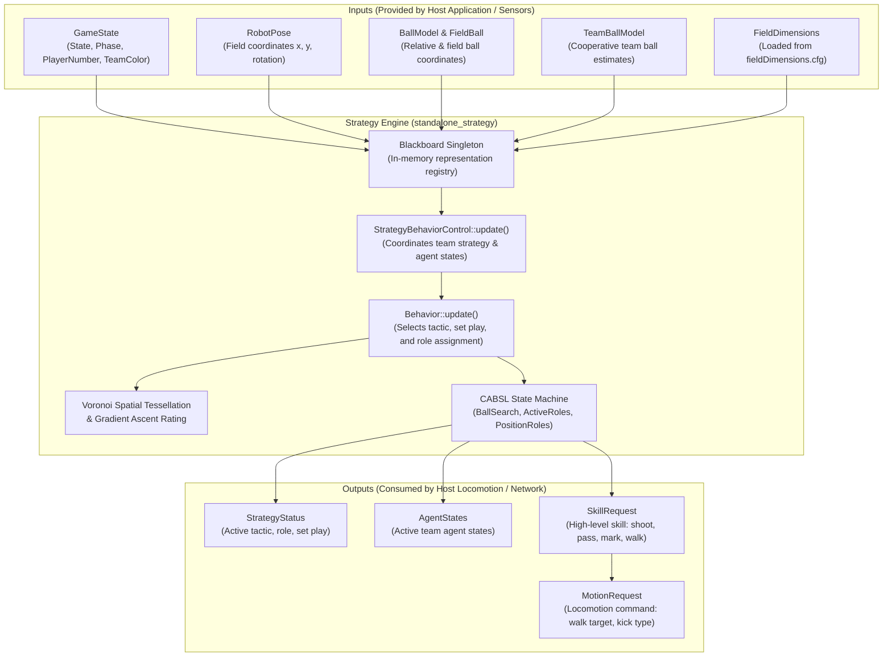

# Architecture & Integration Guide: B-Human Standalone Match Strategy & Behavior Engine

## 1. Executive Summary

This package provides a **100% self-contained, decoupled extraction** of the B-Human high-level match strategy, role assignment, and CABSL behavior control engine from the `BHumanCodeRelease` repository.

All dependencies on SimRobot, NAO hardware drivers, camera matrix computation, robot sensor hardware, and the monolithic framework have been excised and replaced with lightweight, self-contained shims. The engine compiles into an independent static library (`libbhuman_strategy.a`) and test executable (`strategy_test`) using C++20 (`-std=c++20 -O2`) with **zero external dependencies** beyond standard POSIX/C++ standard library headers.

---

## 2. Component Manifest

The files extracted from the B-Human codebase and their respective locations and purposes are listed below:

### 2.1 Strategy, Roles & CABSL State Machines
| Standalone Path | Original B-Human Path | Purpose |
| :--- | :--- | :--- |
| `include/Strategy/StrategyBehaviorControl.h`<br>`src/StrategyBehaviorControl.cpp` | `Src/Modules/BehaviorControl/StrategyBehaviorControl/` | Core strategy module coordinating tactics, role assignments, and team strategy updates |
| `include/Strategy/Behavior.h`<br>`src/Behavior.cpp` | `Src/Modules/BehaviorControl/StrategyBehaviorControl/` | Main behavior engine coordinating active roles, position roles, Voronoi diagrams, and set plays |
| `include/Strategy/ActiveRoles/*`<br>`src/PlayBall.cpp`, `KickOffForward.cpp`, `FreeKickWall.cpp`, `ClosestToTeamBall.cpp` | `Src/Modules/BehaviorControl/StrategyBehaviorControl/ActiveRoles/` | Active role implementations (e.g., ball player, wall player, kickoff forward) |
| `include/Strategy/PositionRoles/*`<br>`src/Goalkeeper.cpp`, `Defender.cpp`, `Midfielder.cpp`, `Forward.cpp`, `RatingRole.cpp`, `PositionRole.cpp` | `Src/Modules/BehaviorControl/StrategyBehaviorControl/PositionRoles/` | Tactical field position logic, gradient ascent position ratings, and fallback positions |
| `include/Strategy/BallSearch.h`<br>`src/BallSearch.cpp` | `Src/Modules/BehaviorControl/StrategyBehaviorControl/BallSearch.h/.cpp` | CABSL state machine for cooperative and individual ball searching |
| `include/Strategy/Tactic.h`<br>`src/Tactic.cpp` | `Src/Modules/BehaviorControl/StrategyBehaviorControl/Tactic.h/.cpp` | Tactical formations (e.g., 5v5 formations `t211`, `t121`, `t112`, etc.) and priority groups |
| `include/Strategy/SetPlay.h`<br>`src/SetPlay.cpp` | `Src/Modules/BehaviorControl/StrategyBehaviorControl/SetPlay.h/.cpp` | Set-play definitions (kickoff, penalty kick, free kick, corner kick) |
| `include/Strategy/Role.h`<br>`src/Role.cpp` | `Src/Modules/BehaviorControl/StrategyBehaviorControl/Role.h/.cpp` | Active and positional role representations |
| `include/Tools/BehaviorControl/cabsl.h` | `Src/Tools/BehaviorControl/cabsl.h` | C-Action-Based Specification Language (CABSL) hierarchical state machine framework |
| `include/Tools/BehaviorControl/SectorWheel.h`<br>`src/SectorWheel.cpp` | `Src/Tools/BehaviorControl/SectorWheel.h/.cpp` | Geometric angular free-sector analysis for kicking and passing corridors |
| `include/Tools/BehaviorControl/KickSelection.h` | `Src/Tools/BehaviorControl/KickSelection.h` | Kick choice enumerations and request parameters |
| `include/Tools/BehaviorControl/Strategy/Agent.h` | `Src/Tools/BehaviorControl/Strategy/Agent.h` | Team agent model tracking player number, pose, ball validity, and role |

### 2.2 Representations
| Standalone Path | Original B-Human Path | Purpose |
| :--- | :--- | :--- |
| `include/Representations/BehaviorControl/SkillRequest.h`<br>`src/SkillRequest.cpp` | `Src/Representations/BehaviorControl/SkillRequest.h/.cpp` | High-level skill request produced by behavior (pass, shoot, walk, mark, etc.) |
| `include/Representations/BehaviorControl/StrategyStatus.h`<br>`src/StrategyStatus.cpp` | `Src/Representations/BehaviorControl/StrategyStatus.h/.cpp` | Current tactical status, active roles, and set play assignments |
| `include/Representations/BehaviorControl/AgentStates.h`<br>`src/AgentStates.cpp` | `Src/Representations/BehaviorControl/AgentStates.h/.cpp` | Shared agent state list for multi-robot coordination |
| `include/Representations/BehaviorControl/FieldBall.h`<br>`src/FieldBall.cpp` | `Src/Representations/BehaviorControl/FieldBall.h/.cpp` | Filtered ball coordinates and velocities relative to robot and on field |
| `include/Representations/BehaviorControl/FieldInterceptBall.h`<br>`src/FieldInterceptBall.cpp` | `Src/Representations/BehaviorControl/FieldInterceptBall.h/.cpp` | Ball intercept calculations and interception trajectory data |
| `include/Representations/BehaviorControl/IndirectKick.h` | `Src/Representations/BehaviorControl/IndirectKick.h` | Rules governing whether a direct kick on goal is permitted |
| `include/Representations/Infrastructure/GameState.h`<br>`src/GameState.cpp` | `Src/Representations/Infrastructure/GameState.h/.cpp` | Game controller state, half, scores, penalties, and own/opponent team attributes |
| `include/Representations/Infrastructure/FrameInfo.h` | `Src/Representations/Infrastructure/FrameInfo.h` | Frame timestamp tracking (in milliseconds) |
| `include/Representations/Modeling/RobotPose.h`<br>`src/RobotPose.cpp` | `Src/Representations/Modeling/RobotPose.h/.cpp` | 2D robot pose on the field `(x, y, rotation)` and covariance |
| `include/Representations/Modeling/BallModel.h` | `Src/Representations/Modeling/BallModel.h` | Raw and estimated local ball position and velocity |
| `include/Representations/Modeling/TeamBallModel.h` | `Src/Representations/Modeling/TeamBallModel.h` | Fused global ball model aggregated across all communicating teammates |
| `include/Representations/Modeling/ObstacleModel.h`<br>`src/Obstacle.cpp` | `Src/Representations/Modeling/ObstacleModel.h`, `Src/Tools/Modeling/Obstacle.cpp` | Detected field obstacles (opponents, teammates, unknown robots) |
| `include/Representations/Modeling/GlobalOpponentsModel.h`<br>`src/GlobalOpponentsModel.cpp` | `Src/Representations/Modeling/GlobalOpponentsModel.h/.cpp` | Clustered estimates of opponent player positions |
| `include/Representations/Modeling/GlobalTeammatesModel.h`<br>`src/GlobalTeammatesModel.cpp` | `Src/Representations/Modeling/GlobalTeammatesModel.h/.cpp` | Positions, velocities, and walk targets of teammates |
| `include/Representations/Configuration/FieldDimensions.h`<br>`src/FieldDimensions.cpp` | `Src/Representations/Configuration/FieldDimensions.h/.cpp` | Standard RoboCup SPL / HSL field dimensions, lines, penalty marks, goal posts |
| `include/Representations/Configuration/SetupPoses.h`<br>`src/SetupPoses.cpp` | `Src/Representations/Configuration/SetupPoses.h/.cpp` | Preconfigured starting formations and kickoff poses |
| `include/Representations/Configuration/BehaviorParameters.h` | `Src/Representations/Configuration/BehaviorParameters.h` | Tunable strategy thresholds (ball search timeout, kick distances, etc.) |
| `include/Representations/Configuration/BallSpecification.h` | `Src/Representations/Configuration/BallSpecification.h` | Physical ball radius, friction, and speed limits |
| `include/Representations/MotionControl/MotionRequest.h`<br>`src/MotionRequest.cpp` | `Src/Representations/MotionControl/MotionRequest.h/.cpp` | Low-level motion command (walk, stand, kick, walk target) |
| `include/Representations/MotionControl/WalkingEngineOutput.h` | `Src/Representations/MotionControl/WalkingEngineOutput.h` | Maximum robot translation and rotation walking speeds |
| `include/Representations/Communication/TeamData.h`<br>`src/TeamData.cpp` | `Src/Representations/Communication/TeamData.h/.cpp` | Team broadcast packet data container |

### 2.3 Math, Geometry & 3rd-Party Vendored Libraries
| Standalone Path | Original Path | Purpose |
| :--- | :--- | :--- |
| `include/Eigen/*` | `Util/SimRobot/Util/Eigen/Eigen` | Vendored linear algebra templates (matrices, vectors, solvers) |
| `include/voronoi/*` | `Src/Representations/BehaviorControl/Libraries/LibPosition/voronoi/` | 2D Voronoi diagram generator for tactical spatial partitioning |
| `include/Math/*`, `include/MathBase/*`<br>`src/Geometry.cpp`, `Covariance.cpp`, `BallPhysics.cpp`, `LeastSquares.cpp`, `Random.cpp`, `RotationMatrix.cpp` | `Src/Libs/Math/`, `Src/Libs/MathBase/` | Angle arithmetic, 2D/3D transformations, circle/line intersections, ball decay dynamics |

### 2.4 Streaming, Serialization & Reflection
| Standalone Path | Original Path | Purpose |
| :--- | :--- | :--- |
| `include/Streaming/*`<br>`src/Streamable.cpp`, `InOut.cpp`, `InStreams.cpp`, `OutStreams.cpp`, `InExpr.cpp`, `SimpleMap.cpp`, `TypeRegistry.cpp`, `TypeInfo.cpp`, `FunctionList.cpp` | `Src/Libs/Streaming/` | Reflection registry, symbolic expression evaluation, and `.cfg` file deserialization |
| `include/Platform/File.h`<br>`src/File.cpp` | `Src/Libs/Platform/File.h`, `Src/Libs/Platform/Linux/File.cpp` | Cross-platform configuration file search and loading |

### 2.5 Configuration Files
| Standalone Path | Original B-Human Path | Purpose |
| :--- | :--- | :--- |
| `config/fieldDimensions.cfg` | `Config/Locations/Default/fieldDimensions.cfg` | Dimensions of the field, goal posts, markings |
| `config/ballSpecification.cfg` | `Config/ballSpecification.cfg` | Ball radius, mass, friction parameters |
| `config/behaviorParameters.cfg` | `Config/behaviorParameters.cfg` | Behavior timing, search thresholds, and offsets |
| `config/setupPosesProvider.cfg` | `Config/setupPosesProvider.cfg` | Kickoff and penalty setup coordinates |
| `config/strategyBehaviorControl.cfg` | `Config/strategyBehaviorControl.cfg` | Default match strategy selection |
| `config/role*.cfg` | `Config/role*.cfg` | Role-specific parameters (Defender, Forward, Goalkeeper, Midfielder, PlayBall, RatingRole) |

---

## 3. Decoupling Strategy & Architectural Boundary

```
+---------------------------------------------------------------------------------------------------+
|                                       ORIGINAL B-HUMAN CODEBASE                                   |
|                                                                                                   |
|  [SimRobot GUI]       [Perception & Camera Matrix]       [NAOqi / Hardware HAL]    [Audio/Whistle]|
|         |                           |                              |                      |       |
|         X (EXCISED)                 X (EXCISED)                    X (EXCISED)            X (STUB)|
|         |                           |                              |                      |       |
+---------|---------------------------|------------------------------|----------------------|-------+
          |                           |                              |                      |
          v                           v                              v                      v
+---------------------------------------------------------------------------------------------------+
|                                  STANDALONE STRATEGY ENGINE SHIMS                                 |
|                                                                                                   |
|  [DebugStubs.h]            [RepresentationStubs.cpp]     [PlatformStubs.h]      [Blackboard.h]   |
|  No-op draw macros         Zero-draw representations     POSIX SystemCall stubs In-memory registry|
+---------------------------------------------------------------------------------------------------+
                                              |
                                              v
+---------------------------------------------------------------------------------------------------+
|                                HIGH-LEVEL MATCH STRATEGY ENGINE                                   |
|                                                                                                   |
|    +-------------------------+    +-------------------------+    +---------------------------+    |
|    | StrategyBehaviorControl |<-->|         Behavior        |<-->|   Tactic & Position Roles |    |
|    +-------------------------+    +-------------------------+    +---------------------------+    |
|                 |                              |                                |                 |
|                 v                              v                                v                 |
|    +-------------------------+    +-------------------------+    +---------------------------+    |
|    |      Active Roles       |    |   Voronoi / Gradient    |    |    CABSL State Machines   |    |
|    |   (PlayBall, Wall, etc) |    |    Ascent Field Rating  |    |    (BallSearch, etc)      |    |
|    +-------------------------+    +-------------------------+    +---------------------------+    |
+---------------------------------------------------------------------------------------------------+
                                              |
                                              v
                                  [BHumanStrategy::StrategyEngine]
                                              |
                     +------------------------+------------------------+
                     |                                                 |
                     v                                                 v
           [outputs.skillRequest]                            [outputs.motionRequest]
           (shoot, pass, mark, walk)                         (walkToBallAndKick, walkToPose)
```

### 3.1 What Was Excised vs. Preserved
1. **Perception and Camera Pipeline**: Excised. Perception models (CameraMatrix, ImageCoordinateSystem, FieldLines, PenaltyMarkPercept, etc.) required image processing and camera calibration. In high-level strategy, only `FieldBall` and `RobotPose` are required.
2. **Hardware Drivers & Robotics Middleware**: Excised. NAOqi, Aldebaran SDK, and low-level joint actuators were removed. The engine outputs abstract `SkillRequest` and standard `MotionRequest`.
3. **Debug GUI Drawings (SimRobot)**: Mocked. B-Human embeds hundreds of GUI draw macros (`CIRCLE`, `LINE3D`, `ROBOT`, etc.) directly into representation methods. In `shims/DebugStubs.h`, these are defined as no-ops (`static_cast<void>(0)`), completely severing GUI overhead while allowing representation logic to compile intact.
4. **CABSL Behavior Engine**: Fully Preserved. Hierarchical state machines for ball search, tactical positioning, and role transitions run natively without modification.

### 3.2 In-Memory Blackboard
In B-Human, modules communicate via a global `Blackboard`. In this standalone library, `include/shims/Blackboard.h` provides a thread-safe, self-contained singleton:
- Typed storage: `Blackboard::getInstance().alloc<T>("TypeName")`
- Type-safe retrieval: `Blackboard::getInstance().get<T>()` and `operator[](const char*)`
- Existence queries: `Blackboard::getInstance().exists("TypeName")`
Representations live entirely in memory without requiring inter-thread communication or IPC buffers.

### 3.3 SkillRequest to MotionRequest Translation
The module produces a high-level `SkillRequest` (e.g., `shoot`, `pass`, `walk`, `mark`). To interface directly with robot locomotion controllers, `strategy_wrapper.cpp` translates `SkillRequest` into low-level `MotionRequest` commands:
- `SkillRequest::shoot` / `kick` -> `MotionRequest::walkToBallAndKick`
- `SkillRequest::walk` / `mark` -> `MotionRequest::walk` with target `Pose2f`
- `SkillRequest::stand` -> `MotionRequest::stand`

---

## 4. End-to-End Data-Flow



---

## 5. Embedding & Integration Guide

### 5.1 Copying into an External Codebase
Copy the entire `standalone_strategy/` folder into your target repository (e.g. `external/bhuman_strategy/`):
```bash
cp -r standalone_strategy /path/to/your/project/third_party/bhuman_strategy
```

### 5.2 Building the Static Library
#### Using Make:
```bash
make -C third_party/bhuman_strategy
```
This produces `third_party/bhuman_strategy/libbhuman_strategy.a`.

#### Using CMake:
Add the directory in your `CMakeLists.txt`:
```cmake
add_subdirectory(third_party/bhuman_strategy)
target_link_libraries(your_robot_node PRIVATE bhuman_strategy)
```

### 5.3 C++ Integration Example
Include `Strategy/strategy_wrapper.h` and step the engine inside your robot control loop:

```cpp
#include "Strategy/strategy_wrapper.h"
#include <iostream>

int main()
{
  // 1. Initialize engine with path to config/ directory
  BHumanStrategy::StrategyEngine engine("path/to/standalone_strategy/config", Strategy::s5v5);

  // 2. Prepare tick inputs
  BHumanStrategy::StrategyInputs inputs;
  inputs.gameState = GameState::playing;
  inputs.playerState = GameState::active;
  inputs.playerNumber = 2; // Striker / Forward
  inputs.isGoalkeeper = false;
  inputs.robotPose = Pose2f(0.f, -1000.f, 200.f); // x, y, rotation
  inputs.ballPosition = Vector2f(1200.f, 300.f);
  inputs.ballSeen = true;

  // 3. Step the engine
  BHumanStrategy::StrategyOutputs outputs = engine.step(inputs);

  // 4. Read outputs
  std::cout << "Assigned Role: " << outputs.roleName << std::endl;
  std::cout << "High-Level Skill: " << outputs.skillName << std::endl;
  std::cout << "Motion Command: " << outputs.motionName << std::endl;
  std::cout << "Walk Target: (" 
            << outputs.motionRequest.walkTarget.translation.x() << ", "
            << outputs.motionRequest.walkTarget.translation.y() << ")" << std::endl;

  return 0;
}
```

---

## 6. Verification & Test Execution

Run the built test binary:
```bash
./standalone_strategy/strategy_test
```

### Expected Output:
```text
========================================================
  B-Human Standalone Strategy Engine Verification Test
========================================================

[INIT] Initializing StrategyEngine with config dir: standalone_strategy/config ...
[INIT] Engine successfully initialized.

[INPUTS] Playing state, Player #1 (Field Player)
         Robot Pose: (0, 0, rot=0 rad)
         Ball Pos:   (1500, 200)

--- Executing 5 Ticks of Strategy Update Loop ---

Tick #1:
  Tactic:          t211
  Position:        goalkeeper
  Role Assignment: playBall
  SkillRequest:    shoot -> target=(0, 0, 0 rad)
  MotionRequest:   walkToBallAndKick -> walkTarget=(0, 0)
  Active Agents:   1
--------------------------------------------------------
...
[SUCCESS] Decoupled Strategy Engine executed 5 ticks cleanly.
```
